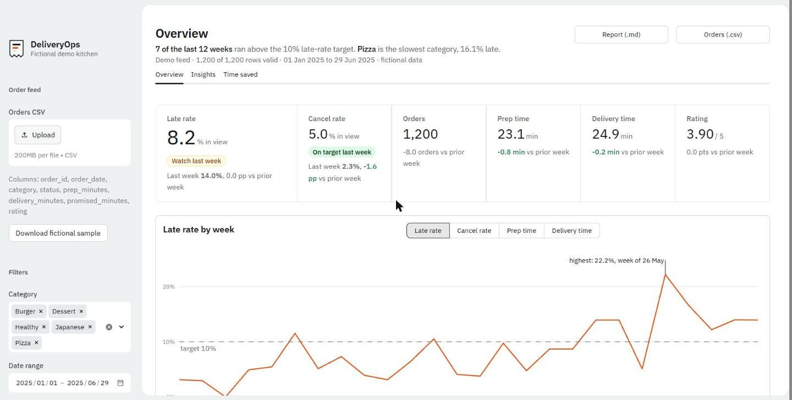

# DeliveryOps AI

A dashboard for small delivery kitchens. Upload a CSV of orders and it tells you how often you're late, which category is dragging the number up, and what to look at first.

[](https://github.com/abiliocoe-source/deliveryops-ai/actions/workflows/ci.yml)

[](LICENSE)



[Leia em português](README.pt-BR.md)

## Why

A restaurant doing delivery usually has its order history in a spreadsheet export and no time to analyse it. The questions are simple: are we late more often than last month? Is it the pizzas or the burgers? Is it the kitchen or the ride? Getting those answers shouldn't need a BI tool.

## What it does

You upload a CSV, or use the built-in sample of 1,200 made-up orders. The app checks the file first. Missing columns stop the import with a message saying which ones. Bad rows (duplicate IDs, unreadable dates, negative times, ratings outside 1 to 5, unknown status) are dropped and the app tells you how many and why, instead of failing or silently ignoring them.

Then it shows:

- a KPI strip (late rate, cancel rate, orders, prep time, delivery time, rating), each with the change against the previous period;
- late rate, cancel rate, prep or delivery time over days, weeks or months, with your target drawn on the two rate charts;
- a table by category, and the order that ran latest drawn as a kitchen ticket: prep and ride time against the promised time, with the minutes over in red;
- an **Insights** tab that splits what it found into facts, hypotheses and recommendations.

That last split is the part I care most about. "Pizza has the highest late rate" is a fact, and it comes with the numbers. "Longer prep in Pizza may be contributing" is a hypothesis, and the app says it isn't confirmed. "Review the Pizza kitchen workflow" is a recommendation, ranked by a rough impact/effort score. Nothing is presented as a cause.

You can export the report as Markdown and the filtered orders as CSV. There's also a small time-savings calculator, clearly labelled as an estimate based only on what you type in.

## How the numbers are defined

| KPI | Definition |
|---|---|
| Late | Delivered, and prep + delivery minutes > promised minutes |
| Late rate | Late orders / delivered orders (cancelled orders don't count) |
| Cancel rate | Cancelled / all orders |
| Avg prep, avg delivery | Delivered orders only |
| Avg rating | Only orders that have a rating |

If a denominator is zero the app shows `n/a`. A 0% late rate on zero deliveries would look like great service, which it isn't.

## Stack

Python and pandas for validation and KPIs, Streamlit for the interface, Plotly for the chart, pytest and GitHub Actions for tests.

All calculations are plain pandas in `deliveryops/metrics.py`, deterministic and covered by tests. That was deliberate: a language model can summarise numbers, but it shouldn't be the thing producing them.

## Running it

```bash
git clone https://github.com/abiliocoe-source/deliveryops-ai.git
cd deliveryops-ai
python -m venv .venv && source .venv/bin/activate   # Windows: .venv\Scripts\activate
pip install -r requirements.txt
streamlit run app.py
```

Tests:

```bash
pip install -r requirements-dev.txt
python -m pytest -q
```

### CSV format

```
order_id, order_date, category, status, prep_minutes, delivery_minutes, promised_minutes, rating
```

`status` is `delivered` or `cancelled`. The sidebar has a button to download the sample file if you want a template.

### Optional: LLM summary

If `LLM_API_KEY` is set (see `.env.example`), the Insights tab can ask any OpenAI-compatible endpoint for a three-sentence summary. The summary is thrown away if it contains any number that doesn't appear in the computed insights. I haven't connected this to a real API; the tests cover the number check and the fallback when there's no key.

## Project layout

```
deliveryops/
  data.py      sample data generator and CSV validation
  metrics.py   KPI calculations
  insights.py  rules that produce facts, hypotheses and recommendations
  export.py    Markdown report and CSV export
  savings.py   time-savings estimate
app.py, ui.py  Streamlit app
```

## Limitations

The sample data is synthetic and the patterns in it were put there on purpose: Pizza is slower, and delays get worse over the six months. Those are not findings about real restaurants. The insight rules use simple thresholds, and the app shows association, not cause.

Ideas for next steps: breaking delays down by hour and delivery zone, and a significance test before calling one category worse than another.

Interface notes are in [docs/DESIGN.md](docs/DESIGN.md), and [DEMO.md](DEMO.md) is a two-minute walkthrough.

## License

[MIT](LICENSE)
