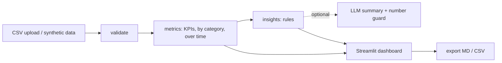
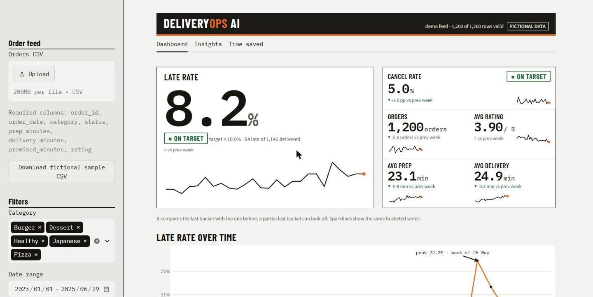
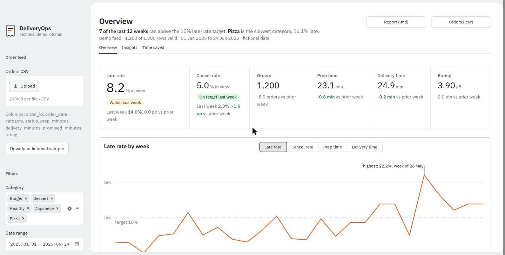
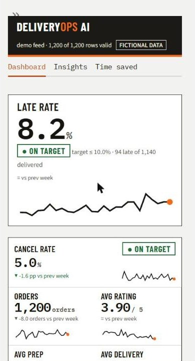
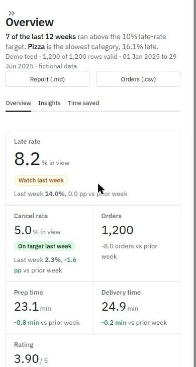

# DeliveryOps AI

Delivery-operations dashboard with a small "insights agent". **All bundled data is synthetic/fictional.** Portuguese version: [README.pt-BR.md](README.pt-BR.md).

## Problem
Small delivery businesses have order data but no quick way to see late/cancelled orders, compare categories and decide what to fix first.

## Solution
Upload a CSV (or use the built-in fictional dataset). The app validates it, computes deterministic KPIs, shows a filterable dashboard, and generates insights split into **facts**, **hypotheses** and **recommendations** (prioritized by impact/effort, each citing evidence). Reports export to Markdown and CSV.

## Stack and why
| Tool | Why |
|---|---|
| Python + Pandas | simple, testable KPI logic |
| Streamlit | fast UI with filters, upload and downloads |
| Plotly | interactive charts |
| pytest | unit tests incl. edge cases |
| `requests` (optional) | call any OpenAI-compatible LLM endpoint |

## Architecture

The LLM never computes anything: it only rewrites already-computed insights, and its output is discarded if it contains numbers not present in the evidence. Without `LLM_API_KEY` the app runs fully on local rules.

## Design
Art direction (taste-skill style `framed-sheet`, applied inside Streamlit): a kitchen pass. A stainless-steel frame (the sidebar) holds a white sheet where the data sits; the one chart hue is the brand orange; text is IBM Plex Sans and only table figures use IBM Plex Mono. The screen answers one question first (is the weekly late rate holding under target, and where does it break?), with the finding written under the title from the computed data. KPIs are a single divided strip (no tiles, no sparklines), and the "most late order" is drawn as a kitchen ticket: prep and ride time against the promised mark, minutes over in red.

| Before | After |
|---|---|
|  |  |
|  |  |

More: [table and ticket](docs/screenshots/after/desktop-1440-table-coupon.jpg), [mobile chart](docs/screenshots/after/mobile-390-chart.jpg). No external images are used, so there is nothing to credit.
Checked with the skill's linter and inspector (0 FAIL; the one warning is Streamlit's own icon font counted as a third typeface on phones) and by eye in Chrome at 1440 and 390 px. The inspector was run on a copy with longer wait times so Streamlit could finish rendering. Keyboard use and screen readers were not tested with assistive technology. Known flaw: on a phone the chart line touches the "target 10%" label.

## Run
```bash
python -m venv .venv && source .venv/bin/activate   # Windows: .venv\Scripts\activate
pip install -r requirements.txt
streamlit run app.py
```
Optional LLM: copy `.env.example`, set `LLM_API_KEY` (and optionally `LLM_BASE_URL`, `LLM_MODEL`) as environment variables. Never commit real keys.

## CSV format
Columns: `order_id, order_date, category, status (delivered|cancelled), prep_minutes, delivery_minutes, promised_minutes, rating`. Invalid rows (duplicates, bad dates, negative times, ratings outside 1-5, unknown status) are removed and reported; missing columns stop the import with a clear message.

## KPI definitions
- **Late**: delivered and `prep + delivery > promised_minutes`. **Late rate** = late / delivered.
- **Cancel rate** = cancelled / all orders.
- **Avg prep/delivery**: delivered orders only. **Avg rating**: rated orders only.
- Empty denominators return `n/a`, never a fake 0.

## Test
```bash
python -m pytest -q
```

## Measured results (seed 42, 1200 fictional orders)
- 13 pytest tests pass (local run).
- Dataset KPIs: late rate 8.2%, cancel rate 5.0%, avg rating 3.90. By construction Pizza has the highest late rate (16.1%) and late rate rises over the 6 months. These patterns were put there by the generator; they are **not** real-world findings.
- The Streamlit app was smoke-tested headlessly (no exceptions, KPIs render). It has **not** been visually inspected in a browser.

## Savings calculator
Estimate = orders/month x manual minutes x automation share. Always labeled ESTIMATE; depends only on your inputs.

## LLM integration: possible, not connected
This is a portfolio demonstration and runs entirely in local mode (rules only). An optional adapter (`llm_summary` in `deliveryops/insights.py`) could call any OpenAI-compatible endpoint when `LLM_API_KEY` is set, and it rejects any answer containing numbers that are not in the evidence. **No real LLM connection was made or tested**, because it was unnecessary for this demo. Tests cover only the guard and the no-key fallback, so treat the LLM path as designed but unverified.

## Limitations
- Synthetic data only demonstrates the pipeline. Rule thresholds are simple heuristics.
- Insights show association, not causation. No n8n webhook (kept out for simplicity).
- LLM path: designed but never connected to a real API (unnecessary for the demo); only the guard and fallback are tested.

## Next steps
Per-hour/zone analysis, statistical tests for differences between categories, webhook alerts.

## Demo (2 min)
See [DEMO.md](DEMO.md).
