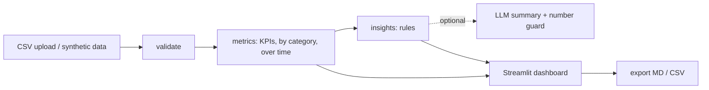

# DeliveryOps AI

Delivery-operations dashboard with a small "insights agent". **All bundled data is synthetic/fictional.** Portuguese version: [README.pt-BR.md](README.pt-BR.md).

## Problem
Small delivery businesses have order data but no quick way to see late/cancelled orders, compare categories and decide what to fix first.

## Solution
Upload a CSV (or use the built-in fictional dataset). The app validates it, computes deterministic KPIs, shows a filterable dashboard, and generates insights split into **facts**, **hypotheses** and **recommendations** (prioritized by impact/effort, each citing evidence). Reports export to Markdown and CSV.

## Stack and why
| Tool | Why |
|---|---|
| Python + Pandas | simple, testable KPI logic |
| Streamlit | fast UI with filters, upload and downloads |
| Plotly | interactive charts |
| pytest | unit tests incl. edge cases |
| `requests` (optional) | call any OpenAI-compatible LLM endpoint |

## Architecture

The LLM never computes anything: it only rewrites already-computed insights, and its output is discarded if it contains numbers not present in the evidence. Without `LLM_API_KEY` the app runs fully on local rules.

## Run
```bash
python -m venv .venv && source .venv/bin/activate   # Windows: .venv\Scripts\activate
pip install -r requirements.txt
streamlit run app.py
```
Optional LLM: copy `.env.example`, set `LLM_API_KEY` (and optionally `LLM_BASE_URL`, `LLM_MODEL`) as environment variables. Never commit real keys.

## CSV format
Columns: `order_id, order_date, category, status (delivered|cancelled), prep_minutes, delivery_minutes, promised_minutes, rating`. Invalid rows (duplicates, bad dates, negative times, ratings outside 1-5, unknown status) are removed and reported; missing columns stop the import with a clear message.

## KPI definitions
- **Late**: delivered and `prep + delivery > promised_minutes`. **Late rate** = late / delivered.
- **Cancel rate** = cancelled / all orders.
- **Avg prep/delivery**: delivered orders only. **Avg rating**: rated orders only.
- Empty denominators return `n/a`, never a fake 0.

## Test
```bash
python -m pytest -q
```

## Measured results (seed 42, 1200 fictional orders)
- 13 pytest tests pass (local run).
- Dataset KPIs: late rate 8.2%, cancel rate 5.0%, avg rating 3.90. By construction Pizza has the highest late rate (16.1%) and late rate rises over the 6 months. These patterns were put there by the generator; they are **not** real-world findings.
- The Streamlit app was smoke-tested headlessly (no exceptions, KPIs render). It has **not** been visually inspected in a browser.

## Savings calculator
Estimate = orders/month x manual minutes x automation share. Always labeled ESTIMATE; depends only on your inputs.

## Limitations
- Synthetic data only demonstrates the pipeline. Rule thresholds are simple heuristics.
- Insights show association, not causation. No n8n webhook (kept out for simplicity).
- LLM path is untested against a real API (no key available); only the guard and fallback are tested.

## Next steps
Per-hour/zone analysis, statistical tests for differences between categories, webhook alerts.

## Demo (2 min)
See [DEMO.md](DEMO.md).
