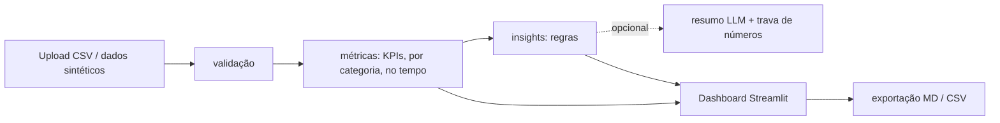

# DeliveryOps AI

Painel de operações de delivery com um pequeno "agente de insights". **Todos os dados incluídos são sintéticos/fictícios.** English: [README.md](README.md).

## Problema
Pequenos deliveries têm dados de pedidos, mas não enxergam rápido atrasos, cancelamentos e diferenças entre categorias, nem o que corrigir primeiro.

## Solução
Envie um CSV (ou use o dataset fictício embutido). O app valida o arquivo, calcula KPIs determinísticos, mostra um dashboard com filtros e gera insights separados em **fatos**, **hipóteses** e **recomendações** (priorizadas por impacto/esforço, sempre com evidência). O relatório exporta para Markdown e CSV.

## Stack e justificativas
| Ferramenta | Por quê |
|---|---|
| Python + Pandas | lógica de KPIs simples e testável |
| Streamlit | UI rápida com filtros, upload e download |
| Plotly | gráficos interativos |
| pytest | testes unitários, incluindo casos extremos |
| `requests` (opcional) | chamar qualquer endpoint LLM compatível com OpenAI |

## Arquitetura

O LLM nunca calcula nada: só reescreve insights já calculados, e a resposta é descartada se tiver números que não estão na evidência. Sem `LLM_API_KEY` tudo roda localmente por regras.

## Design
Direção de arte (estilo `framed-sheet` da taste-skill, aplicado dentro do Streamlit): o passe de uma cozinha. Um quadro de aço inox (a barra lateral) segura uma folha branca onde ficam os dados; o único matiz de gráfico é o laranja da marca; o texto é IBM Plex Sans e só as figuras de tabela usam IBM Plex Mono. A tela responde primeiro uma pergunta (a taxa de atraso semanal está abaixo da meta e onde ela quebra?), com o achado escrito sob o título a partir dos dados calculados. Os KPIs são uma faixa única dividida (sem tiles, sem sparklines) e o "pedido mais atrasado" é desenhado como um cupom de cozinha: tempo de preparo e entrega contra a marca do prazo, minutos excedidos em vermelho.

| Antes | Depois |
|---|---|
|  |  |
|  |  |

Mais: [tabela e cupom](docs/screenshots/after/desktop-1440-table-coupon.jpg), [gráfico no celular](docs/screenshots/after/mobile-390-chart.jpg). Não há imagens externas, então não há créditos.
Conferido com o linter e o inspetor da skill (0 FAIL; o único aviso é a fonte de ícones do próprio Streamlit contada como terceira fonte no celular) e a olho no Chrome em 1440 e 390 px. O inspetor rodou numa cópia com esperas maiores para o Streamlit terminar de renderizar. Teclado e leitores de tela não foram testados com tecnologia assistiva. Defeito conhecido: no celular a linha do gráfico encosta no rótulo "target 10%".

## Execução
```bash
python -m venv .venv && .venv\Scripts\activate
pip install -r requirements.txt
streamlit run app.py
```
LLM opcional: defina `LLM_API_KEY` (e opcionalmente `LLM_BASE_URL`, `LLM_MODEL`) como variáveis de ambiente (veja `.env.example`). Nunca versione chaves reais.

## Formato do CSV
Colunas: `order_id, order_date, category, status (delivered|cancelled), prep_minutes, delivery_minutes, promised_minutes, rating`. Linhas inválidas (duplicadas, datas ruins, tempos negativos, nota fora de 1-5, status desconhecido) são removidas e reportadas; coluna ausente interrompe a importação com mensagem clara.

## Definições dos KPIs
- **Atrasado**: entregue e `preparo + entrega > promised_minutes`. **Taxa de atraso** = atrasados / entregues.
- **Taxa de cancelamento** = cancelados / todos os pedidos.
- **Tempos médios**: só pedidos entregues. **Nota média**: só pedidos avaliados.
- Denominador vazio retorna `n/a`, nunca um 0 falso.

## Testes
```bash
python -m pytest -q
```

## Resultados medidos (seed 42, 1200 pedidos fictícios)
- 13 testes pytest passam (execução local).
- KPIs do dataset: atraso 8,2%, cancelamento 5,0%, nota média 3,90. Por construção, Pizza tem o maior atraso (16,1%) e o atraso sobe ao longo dos 6 meses. Esses padrões foram colocados pelo gerador; **não** são achados do mundo real.
- O app foi testado de forma automatizada (sem exceções, KPIs renderizam). **Não** foi inspecionado visualmente em navegador.

## Calculadora de economia
Estimativa = pedidos/mês x minutos manuais x parcela automatizada. Sempre rotulada ESTIMATIVA; depende só das suas premissas.

## Integração com LLM: possível, não conectada
Este é um projeto de demonstração de portfólio e roda inteiramente em modo local (só regras). Um adaptador opcional (`llm_summary` em `deliveryops/insights.py`) poderia chamar qualquer endpoint compatível com OpenAI quando `LLM_API_KEY` estiver definida, e descarta qualquer resposta com números que não estejam na evidência. **Nenhuma conexão real com LLM foi feita ou testada**, porque era desnecessária para esta demo. Os testes cobrem só a trava e o fallback sem chave; trate o caminho com LLM como projetado, mas não verificado.

## Limitações
- Dados sintéticos só demonstram o pipeline. Os limiares das regras são heurísticas simples.
- Os insights mostram associação, não causalidade. Sem webhook n8n (omitido por simplicidade).
- Caminho com LLM: projetado, mas nunca conectado a uma API real (desnecessário para a demo); só a trava e o fallback são testados.

## Próximos passos
Análise por hora/região, testes estatísticos entre categorias, alertas via webhook.

## Demo (2 min)
Veja [DEMO.md](DEMO.md).
