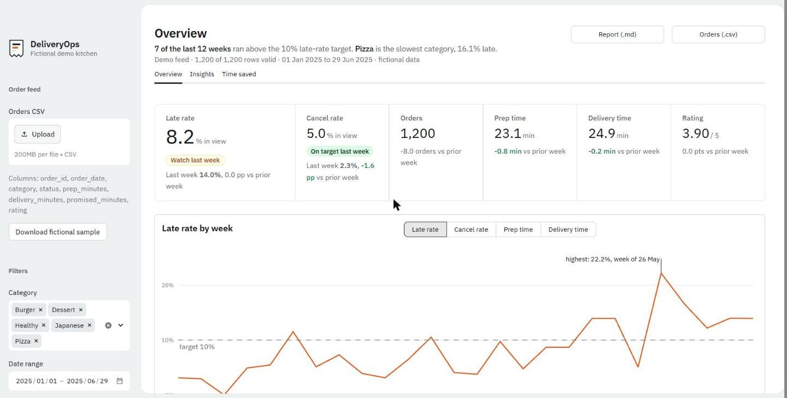

# DeliveryOps AI

Um painel para pequenas cozinhas de delivery. Você sobe um CSV de pedidos e ele mostra com que frequência os pedidos atrasam, qual categoria puxa esse número para cima e por onde começar.

[](https://github.com/abiliocoe-source/deliveryops-ai/actions/workflows/ci.yml)

[](LICENSE)



A interface está em inglês. [Read in English](README.md).

## Por quê

Um restaurante que faz delivery costuma ter o histórico de pedidos numa planilha exportada e nenhum tempo para analisar. As perguntas são simples: estamos atrasando mais que no mês passado? O problema é a pizza ou o hambúrguer? É a cozinha ou a entrega? Responder isso não deveria exigir uma ferramenta de BI.

## O que ele faz

Você sobe um CSV ou usa a amostra embutida, com 1.200 pedidos inventados. O app confere o arquivo antes de tudo. Se falta coluna, a importação para e diz quais. Linhas ruins (ID duplicado, data ilegível, tempo negativo, nota fora de 1 a 5, status desconhecido) são descartadas, e o app informa quantas e por quê, em vez de quebrar ou ignorar em silêncio.

Depois ele mostra:

- uma faixa de KPIs (taxa de atraso, taxa de cancelamento, pedidos, tempo de preparo, tempo de entrega, nota), cada um com a variação em relação ao período anterior;
- taxa de atraso, taxa de cancelamento, preparo ou entrega ao longo de dias, semanas ou meses, com a sua meta desenhada nos gráficos de taxa;
- uma tabela por categoria e o pedido que mais atrasou desenhado como uma comanda de cozinha: preparo e entrega contra o tempo prometido, com os minutos excedentes em vermelho;
- uma aba **Insights** que separa o que foi encontrado em fatos, hipóteses e recomendações.

Essa separação é a parte de que mais gosto. "Pizza tem a maior taxa de atraso" é um fato e vem com os números. "O preparo mais longo da pizza pode estar contribuindo" é uma hipótese, e o app avisa que ela não foi confirmada. "Revisar o fluxo da cozinha de pizza" é uma recomendação, ordenada por uma nota simples de impacto sobre esforço. Nada é apresentado como causa.

Dá para exportar o relatório em Markdown e os pedidos filtrados em CSV. Há também uma pequena calculadora de horas economizadas, marcada como estimativa feita só com o que você digita.

## Como os números são definidos

| KPI | Definição |
|---|---|
| Atrasado | Entregue, e preparo + entrega > tempo prometido |
| Taxa de atraso | Pedidos atrasados / pedidos entregues (cancelados não entram) |
| Taxa de cancelamento | Cancelados / todos os pedidos |
| Preparo e entrega médios | Só pedidos entregues |
| Nota média | Só pedidos que receberam nota |

Se o denominador é zero, o app mostra `n/a`. Uma taxa de atraso de 0% sobre zero entregas pareceria ótimo serviço, e não é.

## Stack

Python e pandas para validação e KPIs, Streamlit na interface, Plotly no gráfico, pytest e GitHub Actions nos testes.

Todos os cálculos são pandas puro em `deliveryops/metrics.py`, determinísticos e cobertos por testes. Foi de propósito: um modelo de linguagem pode resumir números, mas não deveria ser quem os produz.

## Como rodar

```bash
git clone https://github.com/abiliocoe-source/deliveryops-ai.git
cd deliveryops-ai
python -m venv .venv && source .venv/bin/activate   # Windows: .venv\Scripts\activate
pip install -r requirements.txt
streamlit run app.py
```

Testes:

```bash
pip install -r requirements-dev.txt
python -m pytest -q
```

### Formato do CSV

```
order_id, order_date, category, status, prep_minutes, delivery_minutes, promised_minutes, rating
```

`status` é `delivered` ou `cancelled`. A barra lateral tem um botão para baixar a amostra, que serve de modelo.

### Opcional: resumo com LLM

Com `LLM_API_KEY` definida (veja `.env.example`), a aba Insights pode pedir a qualquer endpoint compatível com a API da OpenAI um resumo de três frases. O resumo é descartado se trouxer algum número que não aparece nos insights calculados. Não conectei isso a uma API real; os testes cobrem a checagem de números e o comportamento sem chave.

## Estrutura

```
deliveryops/
  data.py      gerador da amostra e validação do CSV
  metrics.py   cálculo dos KPIs
  insights.py  regras que geram fatos, hipóteses e recomendações
  export.py    relatório em Markdown e exportação CSV
  savings.py   estimativa de horas economizadas
app.py, ui.py  app em Streamlit
```

## Limitações

A amostra é sintética, e os padrões nela foram colocados de propósito: pizza é mais lenta e os atrasos pioram ao longo dos seis meses. Não são descobertas sobre restaurantes reais. As regras de insight usam limites simples, e o app mostra associação, não causa.

Próximos passos possíveis: quebrar os atrasos por horário e região de entrega, e aplicar um teste de significância antes de dizer que uma categoria é pior que outra.

As notas de interface estão em [docs/DESIGN.md](docs/DESIGN.md), e o [DEMO.md](DEMO.md) tem um roteiro de dois minutos.

## Licença

[MIT](LICENSE)
