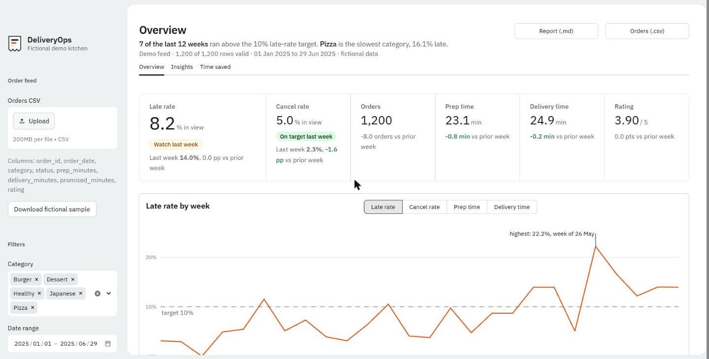
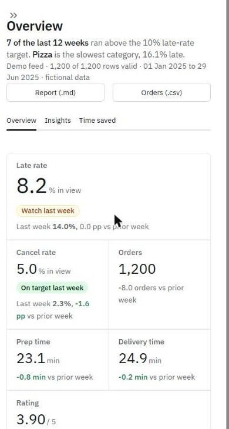
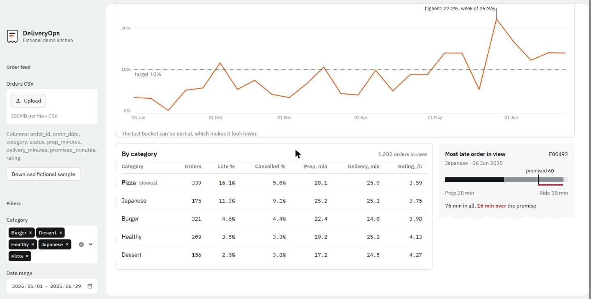
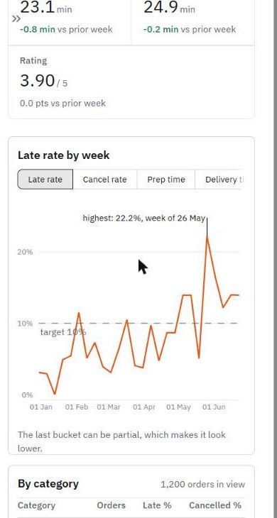

# Interface notes

The look borrows from a kitchen pass: the sidebar is a steel-grey frame and the data sits on a white sheet inside it. There's one chart colour, the brand orange. Text is IBM Plex Sans, and IBM Plex Mono is used only for figures in tables, so columns of numbers line up.

The screen is meant to answer one question before anything else: is the weekly late rate holding under target, and if not, where does it break? The sentence under the title is built from the computed data each time ("8 of the last 12 weeks ran above the 10% late-rate target. Pizza is the slowest category..."), never typed in by hand.

A few other decisions:

- **KPIs are one divided strip**, not a grid of cards with sparklines. Each one has a short line in words for the change against the previous period, and the two rates get an On target / Watch / Off target pill.
- **The latest-running order is drawn as a kitchen ticket**: prep and ride time as bars against the promised-time mark, minutes over in red. It makes "late" concrete in a way a percentage doesn't.
- **The last bucket of the chart can be partial**, which makes it look better than it is. There's a footnote under the chart saying so.

## Screenshots

| Desktop | Phone |
|---|---|
|  |  |
|  |  |

## What I checked and what I didn't

Checked by eye in Chrome at 1440 px and 390 px wide. One known flaw: on a phone, the chart line touches the "target 10%" label.

Keyboard navigation and screen readers were not tested with assistive technology.
